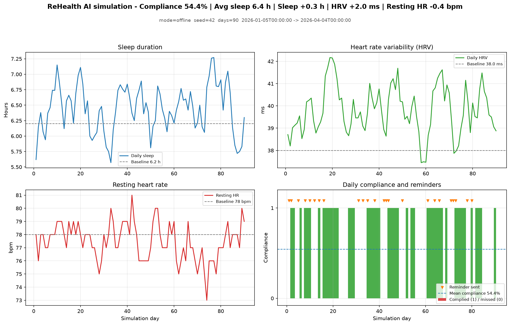

# ReHealth HealthAgent

[English](README.md) | **简体中文**

一个**确定性**的小型模拟器，用于研究行为健康干预中「依从性 — 情绪 — 生理」三者如何相互作用。

它只诚实地回答一个问题：*给定一个患者画像、一个干预方案和一套合理的依从模型，会得到什么轨迹——以及为什么？*

> **仅供研究与演示。** 本软件不是医疗器械，不是诊断工具，也不构成任何临床建议。不得将任何输出用于真实个人的医疗决策。

---

## v0.2 改了什么

v0.1 是一个跑不起来的 demo：引擎 import 了一个不存在的函数，所有示例在 import 阶段就失败，依赖清单漏掉了代码真正 import 的包，某模块写死了本机路径，而所谓「随机种子」形同虚设——唯一的随机性来源是一次 LLM 调用。首页那张演示图展示的是一个「全程依从」的干预把每项生物指标都弄得更差。

v0.2 保留同样的领域思路，重写了内部实现：

| 维度 | v0.1 | v0.2 |
|---|---|---|
| 反馈环 | 依从性从不影响压力 | 依从 → 减压 → 生理 → 提醒 → 依从 |
| 压力项 | 用绝对压力，重复计算慢性压力 | 只用**超出患者自身基线**的部分 |
| 效应量 | 绝对常数（HRV −8 ms/天） | 相对各自基线，且锚定「零依从 = 零变化」 |
| 依从模型 | 每天 1 次 LLM，无回退、无超时 | 可选；JSON 模式、重试、预算、熔断、确定性回退 |
| 可复现 | 声称可复现，实际不可能 | 固定 seed + 起始日期时，离线运行逐字节一致 |
| 提醒优先级 | `max("high", "medium") == "medium"` | `IntEnum`，紧急日绕过冷却 |
| 指标口径 | 最后一天减基线 | 末 14 天均值减基线 |
| 入口 | 5 个里 4 个跑不通 | 文档里的每条命令都在 CI 里跑 |
| 依赖 | 4 个没用上、2 个缺失 | 只声明代码真正 import 的包 |
| 测试 | 无（`test.py` 里没有任何断言） | pytest 套件，CI 覆盖 3.10 / 3.12 |

迁移说明见 [CHANGELOG.md](CHANGELOG.md)。

---

## 演示

内置「高压力」人设的 90 天离线运行，可用下面的命令复现：

```bash
python simulate.py --offline --plan sleep_optimization --days 90 \
                   --seed 42 --start-date 2026-01-05 --out outputs
python visualize.py
```



该次运行结果：依从率 54.4%，睡眠 **+0.26 小时**，HRV **+1.96 ms**，静息心率 **−0.43 bpm**。数字刻意保守：依从率约 50% 时模型本就预测变化很小；对这个画像而言，睡眠专项方案优于通用混合方案（混合方案睡眠仅 +0.01 小时）。想看到模型的最好情况，可调高患者字典里的动机/习惯强度——测试套件断言「依从越高，结果必须越好」。

---

## 快速开始（无需 API Key，约 1 秒）

```bash
git clone https://github.com/csong8904-spec/ReHealthAI-HealthAgent.git
cd ReHealthAI-HealthAgent
python -m venv .venv
source .venv/bin/activate        # Windows: .venv\Scripts\activate
pip install -e ".[dev]"

python simulate.py --offline --days 90 --seed 42
python visualize.py              # 需要 plot 附加依赖，见下
pytest -q
```

`--offline` 使用确定性的规则依从模型：不联网、不需要 Key、零成本——演示、测试和 CI 都用这个模式。

画图需要 matplotlib：`pip install -e ".[plot]"`（或 `pip install matplotlib`）。

---

## 两种依从后端

整个模拟由四个小状态机组成。**其中只有一个可能调用 LLM**，而且是可选的：

| 模块 | 建模内容 | 是否调 LLM |
|---|---|---|
| `EmotionAgent` | 压力 / 动机 / 疲劳动态 | 否 |
| `ComplianceAgent` | 每日依从决策 | **可选** |
| `PhysiologyAgent` | HRV、静息心率、睡眠 | 否 |
| `InterventionAgent` | 风险识别 + 提醒策略 | 否 |

```text
        昨天的依从
             │
             ▼
   情绪 ──► 依从 ──► 生理 ──► 提醒策略
      ▲                       │
      └────────── 记录 ◄───────┘
```

### LLM 模式（可选）

```bash
export DEEPSEEK_API_KEY=sk-...
python simulate.py --days 30        # 每个模拟日 1 次 API 调用
```

* `temperature=0`、JSON 响应模式、失败重试、30 秒超时。
* 硬性调用预算：每次运行 `天数 + 5` 次（可用 `SimulationEngine(max_llm_calls=...)` 覆盖）；连续失败 3 次后熔断并回退到规则模型，一次网络抖动不会毁掉 90 天的运行。
* **时延与成本随天数线性增长**：每个模拟日一次串行请求，没有并行（第 n+1 天依赖第 n 天）。对 `deepseek-chat` 实测约 **2 秒 / 440 token 每天**，即 7 天约 15 秒 / 3.1k token，90 天约 3 分钟 / 4 万 token。演示、测试和 CI 请用 `--offline`。
* LLM 参与的运行会标记 `reproducible=false`——API 无法逐字节复现。离线运行可以。

---

## Python API

```python
from healthagent import SimulationEngine

engine = SimulationEngine(seed=42, offline=True)
result = engine.run_simulation(
    patient={
        "age": 52,
        "bmi": 27.5,
        "sleep_avg_hours": 6.2,
        "stress_level": "high",   # low | medium | high
    },
    intervention_plan="hybrid",   # 可用 engine.available_plans() 查看
    simulation_days=90,
)

print(result.compliance_rate)         # 有依从的天数占比（含部分依从）
print(result.full_compliance_rate)    # 完整依从（1.0 分）占比
print(result.partial_compliance_rate) # 部分依从（0.6 分）占比
print(result.sleep_improvement)       # 小时，末 14 天均值减基线
print(result.hrv_change)              # ms，末 14 天均值减基线
print(result.summary())               # 可直接 JSON 序列化的字典
print(result.to_dict()["meta"]["baseline"])
```

`compliance_rate` 统计「有依从」的天数；完整/部分两个比率按完成程度拆分（1.0 与 0.6）。`patient` 也可以传 `PatientProfile`；`intervention_plan` 可传名称（`sleep_optimization`、`cardio_fitness`、`stress_management`、`nutrition_plan`、`hybrid`）或 `InterventionPlan` 实例。

### CLI

| 参数 | 默认值 | 含义 |
|---|---|---|
| `--days N` | 90 | 模拟天数，1–730 |
| `--seed N` | 42 | 随机种子 |
| `--plan NAME` | `hybrid` | 内置方案 |
| `--offline` | 关闭 | 强制规则后端（无 Key 时自动启用） |
| `--start-date YYYY-MM-DD` | 今天 | 固定起始日以精确复现 |
| `--out DIR` | `outputs` | JSON 与文本报告的输出目录 |
| `--json` | 关闭 | 把完整结果打印到 stdout |

---

## HTTP API

```bash
pip install -e ".[dev]"
export REHEALTH_DB_PATH=~/.rehealth/patients.db   # 可选
uvicorn api.main:app --reload                     # 在仓库根目录执行
```

| 方法 | 路径 | 用途 |
|---|---|---|
| `GET` | `/health` | 存活检查（公开） |
| `GET` | `/api/simulation/plans` | 列出内置方案 |
| `POST` | `/api/simulation/run` | 运行一次模拟（`days` 1–365） |
| `POST` | `/api/simulation/patient` | 针对已存患者运行并落库 |
| `POST/GET` | `/api/patients` | 创建 / 列出患者 |
| `GET` | `/api/patients/{id}` | 患者档案 |
| `GET` | `/api/patients/{id}/trend` | 近 30 天趋势 |
| `GET` | `/api/patients/{id}/history` | 历史模拟记录 |
| `POST` | `/api/records` | 新增一条每日自报记录 |
| `GET` | `/api/records/{patient_id}` | 某患者最近 N 条记录 |

环境变量：`REHEALTH_API_KEY`（设置后所有 `/api/*` 需要 `X-API-Key`）、`REHEALTH_CORS_ORIGINS`、`REHEALTH_DB_PATH`。

交互式文档由 `/docs` 与 `/openapi.json` 自动生成；其中每一条描述、字段说明与响应说明都是**中英双语**。

数据库是**未加密的 SQLite，且没有审计日志**——只当作合成/测试数据使用。

---

## 模型假设（相信任何数字之前请先读）

* **完全没有标定。** 所有系数都在 [`healthagent/model_params.py`](healthagent/model_params.py)，是可解释的占位值，不是拟合参数。规则依从模型对演示人设恰好给出约 45–55% 的依从率——那是系数的产物，**不是**验证结果。
* **锚定。** 效应都相对患者自身基线衡量：零依从且压力处于基线时，目标值等于基线。这就是模型不会判定「慢性压力患者必然恶化」的原因。
* **超额压力。** 生理模型响应的是 `stress - stress_baseline`；患者基线的睡眠/HRV 本就是在该慢性压力下测得的。
* **闭环。** 成功的依从会降低压力目标并改善睡眠/HRV/静息心率，权重为方案的 `average_effectiveness` 与实际 `compliance_score`。
* **「Agent」只是模块。** 它们是确定性的、可独立测试的状态机，不是自主 LLM 智能体。保留「agent」一词只是为了延续领域语言；上面的架构说明才是准确描述。
* **单患者、单干预、无共病、无治疗升级、无脱落过程。** HRV/静息心率动态是线性的、均值回归的。

---

## 可复现性

对相同的 `(seed, start_date, patient, plan, params)`，离线运行结果逐字节一致。起始日期会影响结果，因为星期几影响压力；请固定它：

```bash
python simulate.py --offline --seed 42 --start-date 2026-01-05 --days 90
```

若省略 `seed`（API 与库的默认行为），运行会取系统熵并报告 `reproducible: false`；CLI 默认 `--seed 42`。

包内为每个 agent 用 SHA-256 派生独立种子（Python 的 `hash()` 每个进程加盐，不能用于此处）。LLM 参与的运行在结果里标记 `reproducible=False`。

---

## 测试

```bash
pytest -q      # 82 个测试，约 4 秒，不联网
```

测试锁定的是真正重要的性质，而不只是「能跑」：

* 相同 seed 产生完全相同的轨迹；
* **依从越高，结果严格越好**（剂量反应）；
* 高压力演示人设不会崩到硬性下限；
* 生物指标始终在合理区间内；
* 紧急提醒永远不会被降级或被冷却吞掉；
* 任意滚动 30 天窗口内提醒数不超上限；
* LLM 后端连续失败会回退并熔断；
* LLM 的「部分依从」按 0.6 计分，而不是 0；
* CLI、HTTP API 与 `to_dict()` 的契约保持稳定；
* 源码树中不存在作者本机的绝对路径。

CI（`.github/workflows/ci.yml`）在 Python 3.10 与 3.12 上跑测试套件，然后执行 CLI、可视化、两个示例和 API import——上面文档里的每条命令都会在每次推送时被执行。

---

## 仓库结构

```text
healthagent/
  model_params.py      全部系数，集中、有注释、可覆盖
  llm.py               可选的 DeepSeek 客户端（重试、JSON、预算）
  models/              患者、方案、轨迹数据类
  agents/              情绪、依从、生理、干预、编排
  engine/              对外入口 SimulationEngine
  patient_db/          SQLite 持久化
  run.py               可选的 agent 框架工具封装
api/                   FastAPI 应用（患者、记录、模拟）
tests/                 pytest 测试
simulate.py            CLI
visualize.py           从结果 JSON 生成图表
examples/              睡眠与有氧两个示例
```

---

## 数据与密钥

* 永远不要提交患者数据、数据集、商业文档或凭据。`.gitignore` 已屏蔽 `artifacts/`、`outputs/`、`*.db`、`*.pdf`、`*.pptx` 与 `.env`。
* `.env.example` 列出了支持的变量，本地复制成 `.env` 再填。
* 除非设置了 `REHEALTH_API_KEY`，API 没有鉴权，也没有速率限制。不要直接公网暴露。

---

## 参与贡献

欢迎提 Issue 和 PR。请保持本仓库现在的标准：任何行为改动都要有可复现的测试，不要新增没有测试覆盖的入口。

```
git checkout -b fix/my-fix
pytest -q
git commit -m "fix: ..."
```

---

## 许可证

Apache License 2.0 — 见 [LICENSE](LICENSE)。

## 免责声明

本软件基于人工设定的假设生成**模拟**轨迹。它不是医疗器械，未经临床结局验证，不得用于诊断、治疗选择或任何针对真实患者的决策。任何关于真实世界有效性的主张，都需要在通过伦理审批后开展前瞻性验证。
